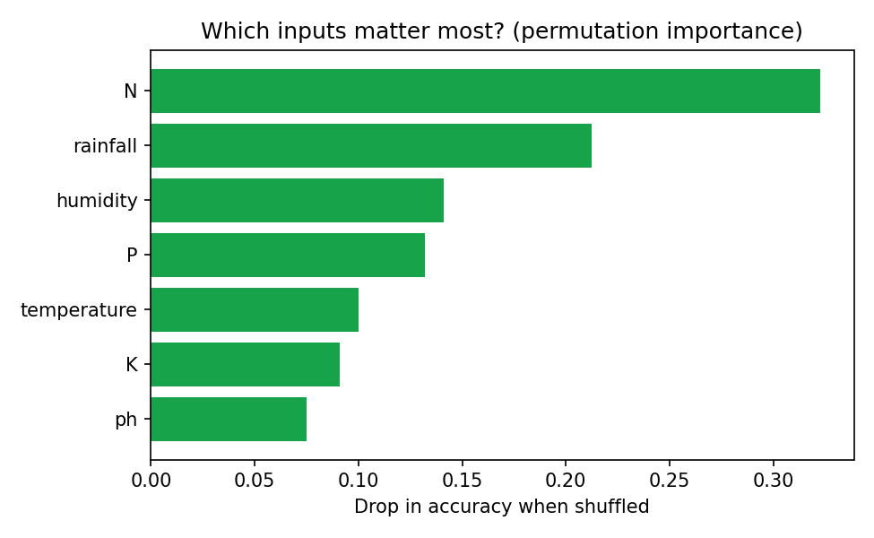
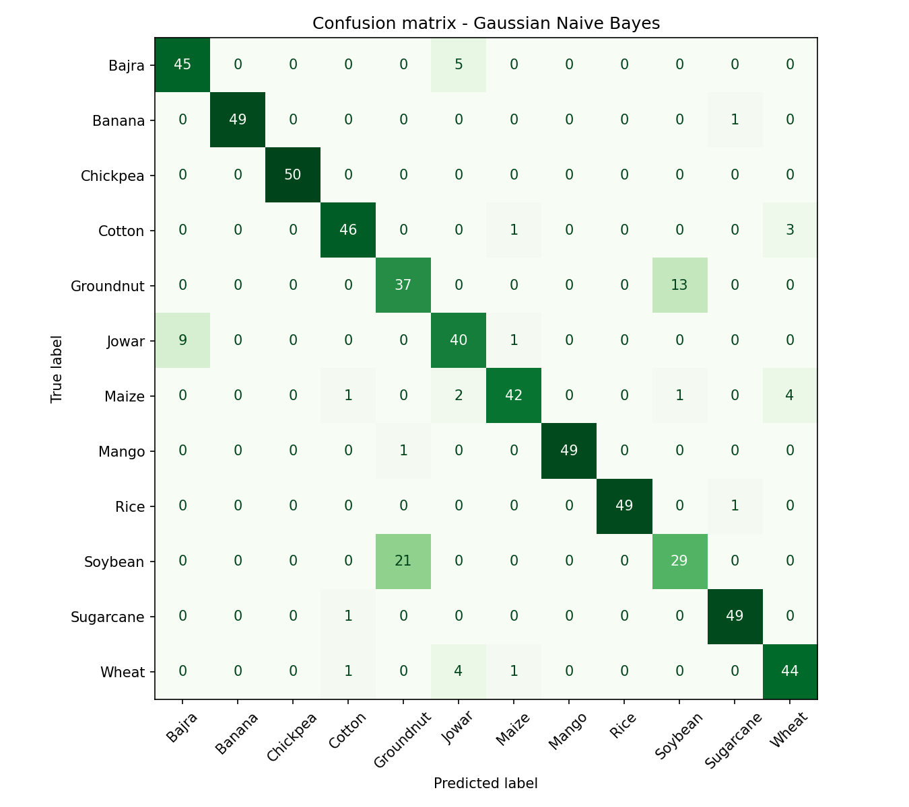

# 🌾 Crop Recommendation System

A machine-learning decision-support tool for farmers: given **soil nutrients (N, P, K), pH, temperature, humidity and rainfall**, it recommends the best-suited crops from 12 major Indian crops and gives **actionable soil-health advice** (liming, fertiliser, irrigation, sowing window).

> **Why it matters:** Choosing the wrong crop wastes inputs and income. Data-driven crop selection supports precision agriculture and sustainable farming.

## Highlights

- **12 Indian crops:** Rice, Wheat, Maize, Cotton, Sugarcane, Soybean, Jowar, Bajra, Chickpea, Groundnut, Banana, Mango (with Kharif / Rabi / perennial season)
- Compares **Decision Tree, kNN, Gaussian Naive Bayes, Logistic Regression, Random Forest** using 5-fold CV
- **Top-3 recommendations with confidence**, because conditions often suit several crops
- **Rule-based soil & climate advisor:** compares your field with the crop's ideal profile and suggests lime/gypsum, N-P-K fertiliser, drainage or irrigation, and sowing adjustments
- **Permutation importance** to show which inputs drive the decision
- **Streamlit app** with sliders, crop guide and model tab, plus a CLI
- pytest suite

## Project structure

```
crop-recommendation-system/
├── app.py                  # Streamlit app
├── src/
│   ├── config.py           # paths, features, crop agronomic profiles
│   ├── generate_data.py    # synthetic dataset around crop profiles
│   ├── train.py            # model comparison, evaluation, plots
│   └── recommend.py        # CropRecommender + soil_advice (CLI + class)
├── tests/test_crops.py
├── data/  models/  reports/
└── requirements.txt
```

## Quick start

```bash
git clone https://github.com/<your-username>/crop-recommendation-system.git
cd crop-recommendation-system
python -m venv .venv && source .venv/bin/activate      # Windows: .venv\Scripts\activate
pip install -r requirements.txt

python -m src.generate_data     # creates data/crop_data.csv (3,000 samples)
python -m src.train             # trains + saves models/crop_model.joblib
streamlit run app.py            # web app
pytest                          # tests
```

### CLI example

```bash
python -m src.recommend --N 90 --P 42 --K 43 --temperature 25 --humidity 82 --ph 5.4 --rainfall 130
```

```
Recommended crops:
  crop  confidence    season
  Rice       0.981    Kharif
Banana       0.013 Perennial
 Maize       0.005    Kharif

Soil & climate advice for the top crop:
  - Soil is acidic (pH 5.4): apply agricultural lime to raise pH towards 6.4.
  - Rainfall (130 mm) is below the ~236 mm Rice needs: plan supplementary irrigation (drip if possible).
```

## Using the real Kaggle dataset

Download the *Crop Recommendation Dataset* (Atharva Ingle) from Kaggle and save it as `data/crop_data.csv`
(columns `N, P, K, temperature, humidity, ph, rainfall, label` → rename `label` to `crop`). Labels are title-cased automatically. Rerun `python -m src.train`.
Note: the advice engine only covers crops defined in `CROP_PROFILES` (`src/config.py`); add profiles for any extra crops.

## Results (bundled synthetic data, seed 42, 600-sample hold-out)

| Model | CV accuracy |
|---|---|
| **Gaussian Naive Bayes** (selected) | **0.903** |
| Logistic Regression | 0.897 |
| Random Forest | 0.882 |
| k-Nearest Neighbours | 0.881 |
| Decision Tree | 0.791 |

- Hold-out accuracy **88%**, macro-F1 **0.88**, **top-3 accuracy 100%**
- Easy crops (Rice, Banana, Mango, Chickpea, Sugarcane) are classified at ≥97% F1; the hardest pair is **Soybean vs Groundnut**, which have similar climate/soil profiles — exactly where a top-3 list is more useful than a single answer
- Most informative inputs: nitrogen, rainfall, humidity, phosphorus

> ⚠️ Data is *synthetic*, generated around typical agronomic profiles with realistic overlap, so metrics show the method works rather than field-validated accuracy. Gaussian Naive Bayes winning is expected because the data are Gaussian by construction; on real data, tree ensembles often win. **Decision-support only — validate with local soil tests and your agriculture extension officer.**

## Visuals




## Tech stack

Python · pandas · NumPy · scikit-learn · Matplotlib · joblib · Streamlit · pytest

## Possible extensions

- Add yield prediction (regression) and profit estimation using mandi prices
- Pull live weather from an API (e.g., Open-Meteo) instead of manual input
- Fertiliser dosage calculator per hectare
- Multi-lingual UI (Marathi / Hindi) for farmers
- Satellite NDVI features for crop-health monitoring

## License

MIT
